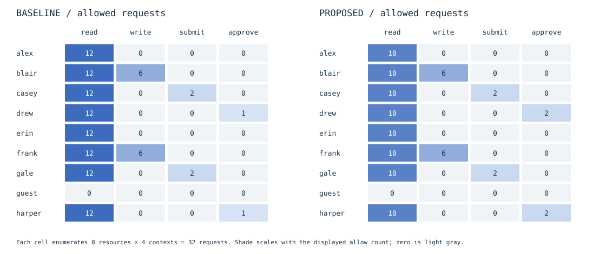

# Access policy audit lab

**[View the report in your browser](https://Michaelhoang8.github.io/access-policy-audit-lab/)**

An offline authorization analysis tool for a deliberately small **custom RBAC-plus-attribute language**. It validates role inheritance, applies explicit-deny precedence and default deny, and compares complete decision matrices before and after policy changes. All users, roles, resources and request contexts are synthetic. No live account is queried or modified.

**[Technical report](docs/report.html)** · [Screenshots](docs/screenshots/README.md) · [Review recording](docs/recordings/README.md) · [Language specification](docs/language.md)



## Recorded findings

Each policy is evaluated on **9 users × 4 actions × 8 resources × 4 contexts = 1,152 requests**. Five policies produce **5,760 decisions**, each checked against an independent evaluator, including matched rules and inheritance explanation paths.

| Policy | Allowed | Newly allowed | Newly denied | Isolation violations | Static role conflicts | Self-approval grants |
| --- | ---: | ---: | ---: | ---: | ---: | ---: |
| Baseline | 114 | 0 | 0 | 0 | 0 | 0 |
| Proposed | 100 | 2 | 16 | 0 | 0 | 0 |
| Unsafe inherited approval | 114 | 0 | 0 | 0 | 2 | 0 |
| Unsafe tenant-deny removal | 228 | 114 | 0 | 114 | 0 | 0 |
| Unsafe self-approval | 116 | 2 | 0 | 0 | 2 | 2 |

The proposed policy removes the public-network approval restriction while retaining MFA and self-approval denies. It also forbids restricted-resource reads on public networks. Two concrete grants and sixteen concrete revocations result. Having no configured violations in this finite domain is **not** an unbounded security proof or an endorsement of that change.

The unsafe inheritance variant is particularly useful: it changes no allow/deny outcomes in this request domain, yet creates two static requester/approver conflicts. Removing the self-approval deny afterward exposes two dynamic violations. Outcome-only diffs would miss the first change; the full matrices retain changed effective roles and rule-match paths even when the final outcome stays the same.

## Reproduce

Use **Node 24**. Runtime code uses Node built-ins; pinned TypeScript and Node typings provide strict static checks.

```sh
npm ci --ignore-scripts
npm run typecheck
npm test
npm run audit -- --output results-local
```

The audit reads the committed policy/domain files. It does not generate replacement inputs or sample requests. `results-local/` and `results-ci/` are ignored. CI first checks preserved evidence, then performs a separate fresh complete audit on Ubuntu/Node 24.

To deliberately replace the committed evidence and report:

```sh
npm run audit
npm run report
```

`npm run generate` recreates the canonical synthetic inputs from [src/fixtures.ts](src/fixtures.ts). Use it only when intentionally resetting those input files. The normal audit does not overwrite policies. Audit outputs in a selected dedicated output directory can be replaced.

## CLI

```sh
npm run cli -- validate data/policies/baseline.json data/domain.json
npm run cli -- explain data/policies/proposed.json data/domain.json drew/approve/alpha-payment/public-mfa
npm run cli -- compare data/policies/baseline.json data/policies/unsafe-no-tenant-deny.json data/domain.json
```

`validate` reports schema/domain validity and request count. `explain` prints the concrete request, decision, matched allow/deny rules, role paths, every rule's selector results, and evaluated condition values. `compare` performs complete evaluation/reference comparison and reports every changed request and configured violation.

Exit status 0 means the command completed; it does **not** mean a request was allowed or a candidate policy is safe. Inspect the JSON decision/findings. Invalid input, an out-of-domain request or execution failure exits with status 2 and a concise error. `npm run cli -- --help` lists the commands. Input files are size-checked before loading.

## Authorization semantics

1. **Validate first.** Policies reject unknown fields/selectors/attributes, invalid types, duplicate IDs, unknown inherited roles and cycles. Runtime requests also require all fields and correct types; missing MFA or an unknown action cannot quietly bypass a condition.
2. **Expand role inheritance.** If `editor` inherits `viewer`, someone assigned `editor` has both roles. Multiple inheritance is allowed; its graph must be acyclic. A subject may have multiple direct roles or none.
3. **Match selectors.** A rule's role, action and resource-kind selectors must all match. A list is an OR within that selector. `['*']` is the only permitted wildcard form and cannot be mixed with named values. Wildcard roles match even a subject with no assigned roles.
4. **Match conditions.** All conditions in a rule are ANDed. Equality and inequality use strict comparisons between typed attribute values or typed literals. An empty condition list is true.
5. **Resolve effects.** Any matching deny produces an explicit deny. Otherwise, any matching allow produces an allow. Otherwise, default deny applies. Rule declaration order is irrelevant.

There is no implicit “more specific wins,” inherited-rule priority, first-match processing, role grant override, or platform-specific IAM interpretation. The exact language is defined in [docs/language.md](docs/language.md).

The baseline intentionally relies on a shared explicit tenant deny rather than repeating tenant checks in every allow. Removing that deny demonstrates how an apparently small policy diff can expose broad inherited allows. The isolation audit constraint is independent of that deny rule, so removing the rule does not remove the check.

## Policy inputs

| File | Change relative to baseline |
| --- | --- |
| [baseline.json](data/policies/baseline.json) | Viewer/editor/requester/approver roles, role-based allows, tenant/MFA/network/self-approval denies. |
| [proposed.json](data/policies/proposed.json) | Removes public-network approval deny; adds public-network restricted-read deny. |
| [unsafe-no-tenant-deny.json](data/policies/unsafe-no-tenant-deny.json) | Removes the explicit tenant boundary deny. |
| [unsafe-inherited-approval.json](data/policies/unsafe-inherited-approval.json) | Adds approver to the roles inherited by requester. |
| [unsafe-self-approval.json](data/policies/unsafe-self-approval.json) | Adds the same inheritance and removes self-approval deny. |

[domain.json](data/domain.json) lists every subject's tenant/direct roles, every resource's tenant/kind/classification/owner, the action list, and all network/MFA contexts. It also defines independent audit constraints:

- **Tenant isolation:** an allowed request may not cross subject/resource tenants.
- **Self-approval:** an allowed `approve` request may not have its subject as resource owner.
- **Static separation of duty:** a subject's effective roles may not contain both members of an exclusive pair. The fixture pair is requester/approver.

Constraints report findings; they do not inject hidden denies into policy evaluation. Subject attributes, role assignments, resource metadata and context are trusted synthetic inputs to this model. Parsing them does not authenticate their origin. A real authorization integration would need authoritative identity/attribute sources and separate enforcement.

## Complete enumeration and witnesses

The Cartesian product includes every declared combination, including requests such as approving a document that have no applicable allow rule. Nothing is sampled, filtered as “uninteresting,” or omitted because it is denied. Input limits allow at most 16 users × 4 actions × 16 resources × 4 contexts = 4,096 requests per policy. The current domain uses 1,152. Oversized or invalid domains fail before enumeration; there is no exploration cutoff later labeled complete.

The bounded claim concerns these fixed users, assignments, resources and contexts. It does not quantify over future users, additional role assignments, new attributes, new resource kinds or unrestricted values.

Witnesses are **minimal in a declared finite order**: subject ID, action name, resource ID and context ID, each ascending ASCII. The audit saves the first concrete request in each nonempty change/violation category. It does not claim a shortest attack trace, smallest policy edit, minimum privilege set or unbounded counterexample. The static role-conflict witness chooses the first conflicting user; the fixture configures one exclusive pair.

Concrete witnesses include:

| Category | First request or subject |
| --- | --- |
| Proposed new grant | `drew/approve/alpha-payment/public-mfa` |
| Proposed revocation | `alex/read/alpha-payment/public-mfa` |
| Tenant isolation failure | `alex/read/beta-internal-doc/corp-mfa` |
| Inherited role conflict | Casey: requester and approver |
| Self-approval failure | `casey/approve/alpha-payment/corp-mfa` |

Each request witness contains the complete before/after rule evaluation, with actual left/right attribute values and predicates. Every member of the corresponding finding/diff category is also retained. Inheritance explanation paths select the fewest role edges, then the lexicographically smallest full path when tied.

## Independent evaluation and tests

The primary evaluator precomputes role closures using DAG recursion and indexes rules by action. The reference evaluator instead uses breadth-first path expansion and scans every rule, with separately implemented attribute lookup and condition matching. It shares validated input types and the declared language, but does not call the optimized evaluator's matcher or closure routine. All 5,760 complete decision objects must agree.

Tests cover deny/default precedence, wildcard subjects without roles, typed conditions, missing attributes, cycles, unknown selectors, multiple inheritance, rule-order independence, input/explanation immutability and known fixture counts. An additional exhaustive path oracle checks **1,024 ordered DAGs on five roles × all 32 assignment subsets = 32,768 role/path comparisons**. This exercises the closure algorithm separately from the request fixtures; it is not a proof over arbitrary graphs.

Preserved-evidence tests validate source/input hashes, replay every stored matrix row, compare findings and all deltas, check matrix hashes and counts, and verify that stored witnesses are the first actual findings with exactly reproducible explanations. CI does this before producing an unrelated fresh result directory.

## Inspect the artifacts

| Artifact | Contents |
| --- | --- |
| [results/summary.json](results/summary.json) | Complete domain dimensions, all policy counts, elapsed timings, and matrix SHA-256 values. |
| [results/matrices/](results/matrices/) | Full JSONL and CSV decision matrices, including matching rule IDs, effective roles and inheritance paths. |
| [results/diffs/](results/diffs/) | Every newly allowed, newly denied and reason-category-changed request relative to baseline. |
| [results/witness-index.json](results/witness-index.json) | Selected minimal witnesses and their files. |
| [results/witnesses/](results/witnesses/) | Concrete request/role witnesses with full before/after explanations. |
| [results/findings-unsafe-no-tenant-deny.json](results/findings-unsafe-no-tenant-deny.json) | All 114 concrete isolation violations. |
| [results/environment.json](results/environment.json) | Runtime/platform/timestamp and normalized input/source hashes. |

The final decision alone is not the whole record. For example, a request can remain denied while changing from an explicit deny to a default deny; `reasonChanged` records that category change. A request can also keep the same reason while its matched rules or role paths change; those details remain in the full matrices rather than being mislabeled as a new grant.

Timings use `performance.now` around primary evaluation and, separately, reference evaluation plus assertions. Parsing, compilation, file writing and report rendering are outside those recorded loops. These single local durations demonstrate an executed audit; they are not repeated benchmark results or production throughput guarantees.

## Parser, state and integration limits

The custom parser requires exact fields, bounded arrays, known enums, typed predicates, valid owners and unique IDs. JSON formatting whitespace may vary, but token spelling must match standard JSON serialization: duplicate keys, alternate numeric forms and noncanonical escapes are rejected by a token round-trip check. Documents are bounded to 65,536 bytes. It is intentionally stricter than accepting every syntactically valid JSON representation.

Public evaluation validates requests and throws on invalid input instead of returning an authorization result. A caller must treat that exception as a rejected request, not as permission. The CLI does so by failing the command. The compiled evaluator owns copied policy data; callers cannot change future decisions through policy objects or returned explanations.

This language does not claim compatibility with AWS IAM, Kubernetes RBAC, SQL grants, Open Policy Agent, XACML or another engine. It does not implement identity authentication, real enforcement, obligations, resource hierarchies, conditions involving time/ranges/sets, delegation, session-role activation, policy retrieval or live account audit. Its purpose is a precise, reviewable finite model and differential analysis.

## Provenance

This is **AI-assisted portfolio work**. The organization and all identities, resources, assignments and contexts are synthetic. Policy matrices, comparisons, witness explanations, tests and report figures come from actual offline execution. Screenshots and recordings show inspection of the report; they do not represent historical manual work or production security experience.

Input/source hashes normalize CRLF to LF. Environment metadata excludes usernames, hostnames and personal paths. No external account access, policy deployment, credential handling or production security impact is claimed.
